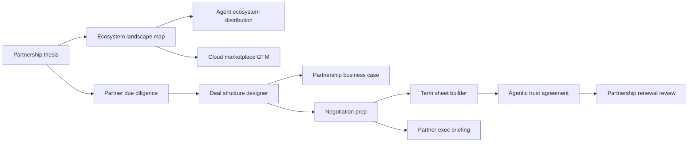

# AI Strategic Partnerships Skills

[](https://github.com/varunk130/ai-strategic-partnerships-skills/actions/workflows/validate.yml)
[](LICENSE)

Twelve Claude Code skills for the deal side of strategic partnerships and business development in the agentic AI era: deciding whether to partner, finding where your capability has to be reachable by agents, structuring and negotiating the deal, and deciding what happens at renewal.

When an agent picks your capability on a user's behalf and runs it inside another company's workflow, the integration is the product experience. These skills treat partnerships with the same rigor as a core product: a thesis, owners, economics both sides can live with, evaluations, and clear trust terms.

**Created and maintained by [Varun Kulkarni](https://github.com/varunk130)**

> All examples in this repository use synthetic companies.

## Contents

- [How the skills fit together](#how-the-skills-fit-together)
- [Skills](#skills)
- [Quickstart](#quickstart)
- [Worked examples](#worked-examples)
- [Documentation](#documentation)
- [Related work](#related-work)
- [License](#license)

## How the skills fit together



Start with a thesis, decide where to show up, check the partner, design and approve the deal, negotiate it, set the trust terms for agents acting across both companies, and review it honestly at term end. The [partnership lifecycle guide](docs/partnership-lifecycle.md) walks through each stage.

## Skills

| Stage | Skill | Use it for |
|-------|-------|-----------|
| Strategy | [partnership-thesis](skills/partnership-thesis/SKILL.md) | The one-page case for why a partnership, with whom, and how you will know it worked |
| Strategy | [ecosystem-landscape-map](skills/ecosystem-landscape-map/SKILL.md) | Mapping platforms, model providers, marketplaces, clouds, SIs, and ISVs by reach, fit, and risk |
| Distribution | [agent-ecosystem-distribution](skills/agent-ecosystem-distribution/SKILL.md) | Getting a capability discovered and selected by agents through MCP, connector directories, and agent marketplaces |
| Distribution | [cloud-marketplace-gtm](skills/cloud-marketplace-gtm/SKILL.md) | Listing, private offers, committed-spend drawdown, and co-sell through cloud marketplaces |
| Diligence | [partner-due-diligence](skills/partner-due-diligence/SKILL.md) | Strategic, technical, AI, security, financial, and reputational checks before committing |
| Deal design | [deal-structure-designer](skills/deal-structure-designer/SKILL.md) | Comparing referral, resell, revenue share, OEM, and commit structures on two-sided economics |
| Deal design | [partnership-business-case](skills/partnership-business-case/SKILL.md) | The internal approval memo: investment, scenarios, leading indicators, and kill criteria |
| Negotiation | [negotiation-prep](skills/negotiation-prep/SKILL.md) | Interests, BATNA, ZOPA, give-get trades, and walk-away triggers |
| Negotiation | [term-sheet-builder](skills/term-sheet-builder/SKILL.md) | A non-binding term sheet with each term marked must-have, tradeable, or walk-away |
| Negotiation | [partner-exec-briefing](skills/partner-exec-briefing/SKILL.md) | A one-page brief for an exec-to-exec meeting and a post-meeting capture |
| Trust | [agentic-trust-agreement](skills/agentic-trust-agreement/SKILL.md) | Shared-responsibility terms when one company's agent acts inside another's systems |
| Renewal | [partnership-renewal-review](skills/partnership-renewal-review/SKILL.md) | Renew, expand, renegotiate, or sunset, judged against the original thesis |

## Quickstart

```bash
git clone https://github.com/varunk130/ai-strategic-partnerships-skills.git
cd ai-strategic-partnerships-skills
./install.sh                      # all skills to ~/.claude/skills
./install.sh negotiation-prep     # or only the ones you need
./install.sh --project            # or into this project's .claude/skills
```

Then ask Claude Code in plain language, for example:

> Draft a partnership thesis for distributing our contract-review agent through a large enterprise platform.

> Prep me for Thursday's negotiation with Halcyon Cloud. Here are their last two emails and our target terms.

## Worked examples

Each example follows one synthetic company through a skill, showing the input and the finished output.

- [Partnership thesis: Kestrel AI and an enterprise workflow platform](examples/partnership-thesis-kestrel-ai.md)
- [Deal structure: Northwind Data embedding a model provider's API](examples/deal-structure-northwind-data.md)
- [Agentic trust agreement: a procurement agent acting in a supplier portal](examples/agentic-trust-agreement-procurement.md)

## Documentation

- [How to use](docs/HOW-TO-USE.md): installing, invoking, and chaining skills
- [Partnership lifecycle](docs/partnership-lifecycle.md): which skill to use at each stage of a deal
- [Skill template](docs/SKILL_TEMPLATE.md): the format every skill follows
- [Contributing](CONTRIBUTING.md)
- [Changelog](CHANGELOG.md)

## Related work

- [ai-ecosystem-partnerships](https://github.com/varunk130/ai-ecosystem-partnerships): run an existing partner portfolio on evidence: scoring, tiering, co-sell account mapping, attribution, QBRs, and joint business plans
- [ai-partner-ecosystem-analysis](https://github.com/varunk130/ai-partner-ecosystem-analysis): research any ISV or partner from its public site
- [ai-gtm-skill-library](https://github.com/varunk130/ai-gtm-skill-library): 37 opinionated GTM skills across the full discover to renew lifecycle
- [ai-revops](https://github.com/varunk130/ai-revops): multi-agent runtime across GTM, Partnerships, and RevOps
- [claude-code-skills](https://github.com/varunk130/claude-code-skills): 42 production-grade skills across AI UX, AI marketing, finance, product, strategy, and game theory

## License

[MIT](LICENSE)
